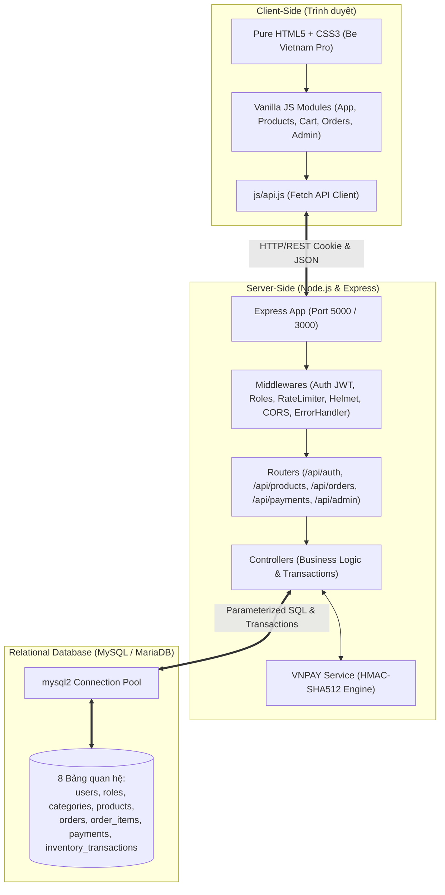
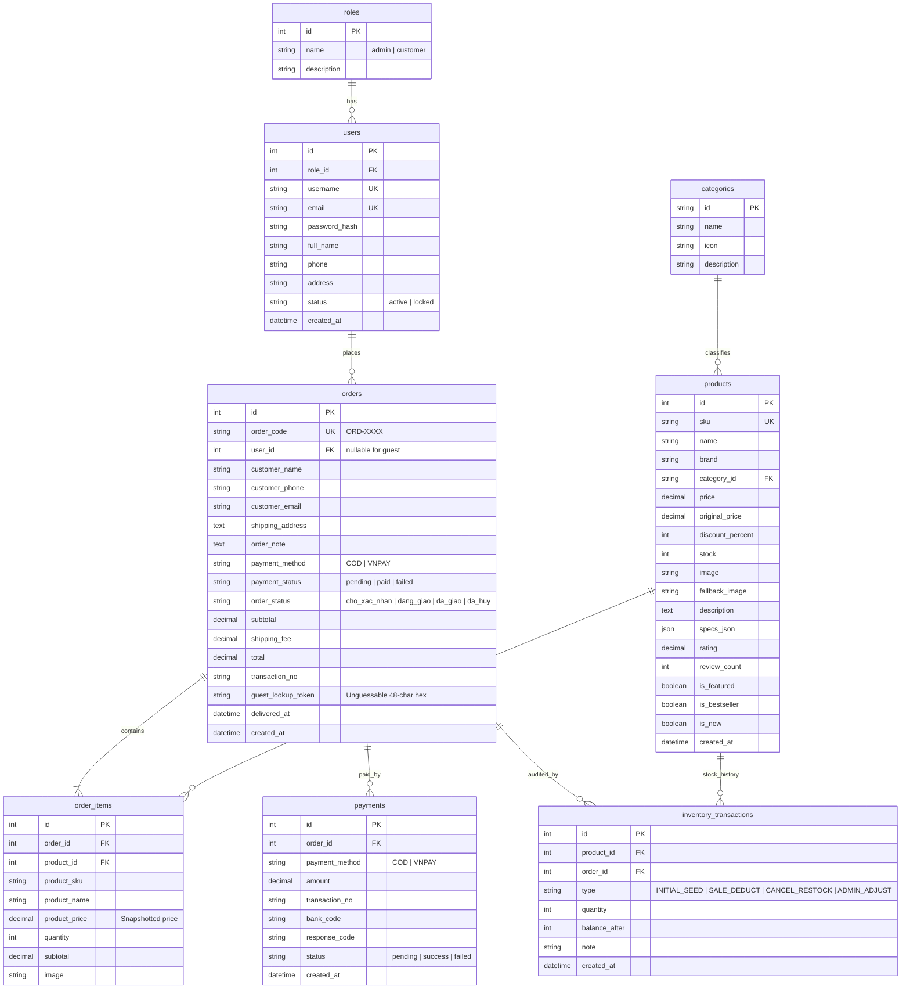

# Store Anh - HỆ THỐNG THƯƠNG MẠI ĐIỆN TỬ BÁN LẺ MÁY TÍNH & LINH KIỆN CÔNG NGHỆ (FULL-STACK)

> **Dự án Bài tập lớn / Đồ án học phần Phát triển Ứng dụng Web**  
> **Kiến trúc Full-Stack:** Frontend Pure HTML5, CSS3 Responsive & Vanilla JavaScript (ES6+) kết nối Backend Node.js (Express REST API) và Cơ sở dữ liệu quan hệ MySQL / MariaDB.  
> **Xác thực & Bảo mật:** JWT qua HttpOnly Cookie, Băm mật khẩu Bcrypt, Chống tấn công CSRF / Rate limiting, Phân quyền chặt chẽ trên từng API endpoint, Transaction phân tầng với row-level lock (`SELECT ... FOR UPDATE`), Tích hợp chữ ký số HMAC-SHA512 cổng thanh toán VNPAY Sandbox.

---

## 1. TỔNG QUAN KIẾN TRÚC HỆ THỐNG

Dự án **Store Anh** được nâng cấp toàn diện từ prototype LocalStorage thành ứng dụng Full-Stack chuẩn production-ready với 3 tầng độc lập:



---

## 2. SƠ ĐỒ THỰC THỂ QUAN HỆ CƠ SỞ DỮ LIỆU (DATABASE ERD)

Hệ thống được thiết kế theo chuẩn cơ sở dữ liệu quan hệ (3NF) với 8 bảng chính:



---

## 3. CÔNG NGHỆ SỬ DỤNG

### Backend & Database
- **Runtime:** Node.js (phiên bản LTS v18+ hoặc v20+).
- **Web Framework:** Express 4.x.
- **Database:** MySQL 8.x hoặc MariaDB 10.x.
- **Database Driver:** `mysql2/promise` (hỗ trợ Connection Pool, Prepared Statements tham số hóa chống SQL Injection).
- **Bảo mật & Xác thực:**
  - `bcryptjs`: Thuật toán băm mật khẩu 10 salt rounds an toàn, không bao giờ lộ mật khẩu thô.
  - `jsonwebtoken` (JWT): Tạo và kiểm tra chữ ký token xác thực phiên người dùng.
  - `cookie-parser`: Quản lý HttpOnly session cookies an toàn trước XSS.
  - `helmet`: Tự động áp dụng các HTTP Security Headers tiêu chuẩn.
  - `express-rate-limit`: Giới hạn tần suất request (chống brute-force đăng nhập / spam order).
  - `cors`: Cấu hình nguồn gốc truy cập nghiêm ngặt.
- **Thanh toán trực tuyến:**
  - `crypto`: Mã hóa chuẩn **HMAC-SHA512** sinh URL thanh toán và xác minh chữ ký VNPAY Sandbox.

### Frontend
- **HTML5:** Semantic HTML (`header`, `main`, `nav`, `section`, `article`, `footer`).
- **CSS3:** Biến CSS Variables, Layout Flexbox và CSS Grid, 100% Responsive trên Mobile/Tablet/Desktop.
- **Pure JavaScript (ES6+):** Mô hình module, Fetch API client kết nối trực tiếp REST backend, xử lý bất đồng bộ `async/await`.
- **LocalStorage:** Được thu gọn chỉ để lưu tạm giỏ hàng draft phía client và token tra cứu đơn của khách vãng lai. Toàn bộ giá bán, tính tiền, trừ kho, quyền admin và đơn hàng được tính toán độc quyền bởi Backend.

---

## 4. TÀI KHOẢN TRUY CẬP DÙNG THỬ (DEMO ACCOUNTS)

Hệ thống đã nạp sẵn dữ liệu mẫu trong migration & seed:

| Vai trò | Email / Username | Mật khẩu mặc định | Quyền hạn & Chức năng kiểm thử |
| :--- | :--- | :--- | :--- |
| **Quản Trị Viên (Admin)** | `admin` | `admin123` | Toàn quyền truy cập Dashboard `/admin`: Thêm/Sửa/Xóa sản phẩm, duyệt đổi trạng thái đơn, khóa tài khoản khách, xem doanh thu thực tế, xuất báo cáo CSV. |
| **Khách Hàng 1** | `khachhang@gmail.com` *(hoặc `user1`)* | `123456` | Khách hàng đã có sẵn các đơn hàng đã giao và đang giao. |
| **Khách Hàng 2** | `tranbinh@gmail.com` *(hoặc `tranbinh`)* | `123456` | Có đơn hàng đang ở trạng thái `cho_xac_nhan` để kiểm tra chức năng **Hủy đơn & Hoàn kho**. |

> **Lưu ý bảo mật:** Các mật khẩu trên chỉ phục vụ demo nội bộ bài tập lớn. Khi triển khai lên môi trường Internet công khai, bắt buộc phải thay đổi các giá trị bí mật trong file `.env`.

---

## 5. HƯỚNG DẪN CÀI ĐẶT VÀ KHỞI CHẠY

### 5.1. Yêu cầu môi trường
- Đã cài đặt **Node.js** (v18 trở lên). Kiểm tra bằng lệnh: `node -v`
- Đã cài đặt **MySQL** hoặc **XAMPP / MariaDB** (đang chạy cổng 3306).

### 5.2. Cấu hình biến môi trường
1. Sao chép file `.env.example` thành `.env`:
   ```bash
   cp .env.example .env
   ```
2. Chỉnh sửa thông số kết nối Database trong file `.env` nếu cần:
   ```env
   PORT=5000
   NODE_ENV=development

   # Database MySQL
   DB_HOST=127.0.0.1
   DB_PORT=3306
   DB_USER=root
   DB_PASSWORD=
   DB_NAME=webbanmt_db

   # JWT Secret Key
   JWT_SECRET=replace_with_a_long_random_secret_before_deployment
   JWT_EXPIRES_IN=7d

   # VNPAY Sandbox Configuration
   VNP_TMN_CODE=your_sandbox_terminal_code
   VNP_HASH_SECRET=your_sandbox_hash_secret
   VNP_URL=https://sandbox.vnpayment.vn/paymentv2/vpcpay.html
   VNP_RETURN_URL=http://localhost:5000/payment/result.html
   ```

### 5.3. Khởi tạo Cơ sở dữ liệu (Migration & Seed)
Chạy lệnh khởi tạo schema 8 bảng và nạp 16 sản phẩm, người dùng mẫu, đơn hàng kiểm thử:
```bash
npm run db:init
```
*(Hoặc chạy lần lượt: `npm run db:migrate` rồi `npm run db:seed`)*

> [!TIP]
> **Dành cho Windows PowerShell:** Nếu bạn gặp thông báo lỗi: `File ... npm.ps1 cannot be loaded because running scripts is disabled on this system`, hãy dùng một trong 2 cách sau:
> 1. Thêm đuôi `.cmd` vào lệnh: `npm.cmd run db:init`, `npm.cmd test`, `npm.cmd start`
> 2. Hoặc mở quyền chạy script trong PowerShell (chạy 1 lần duy nhất):
>    ```powershell
>    Set-ExecutionPolicy -Scope CurrentUser -ExecutionPolicy RemoteSigned
>    ```

### 5.4. Chạy ứng dụng
Khởi động máy chủ backend và web server:
```bash
npm start
```
*(Trên PowerShell nếu bị chặn script, dùng: `npm.cmd start` hoặc `node server/server.js`)*

Truy cập ứng dụng tại trình duyệt: **`http://localhost:5000`**

### 5.5. Chạy bằng Docker Compose (Tùy chọn)
Nếu máy bạn đã cài sẵn Docker Desktop:
```bash
docker-compose up -d --build
```
Hệ thống sẽ tự khởi tạo MySQL container và Node.js container cùng lúc, sau đó mở tại **`http://localhost:5000`**. Các giá trị mặc định trong Compose chỉ dùng cho phát triển cục bộ; hãy thay chúng trước khi triển khai.

---

## 6. BỘ KIỂM THỬ TỰ ĐỘNG (AUTOMATED TEST SUITE)

Dự án tích hợp bộ test tự động sử dụng Node.js Native Test Runner (`node --test`), bao quát toàn diện các luồng nghiệp vụ cốt lõi:

```bash
npm test
```

### Kết quả kiểm thử: **27 / 27 PASS (100%)**
1. **Authentication & Role Permissions (9 tests):**
   - Đăng ký tài khoản mới thành công (mã hóa mật khẩu bằng bcrypt).
   - Từ chối đăng ký khi trùng email.
   - Đăng nhập khách hàng trả về JWT token và gán httpOnly cookie.
   - Đăng nhập quản trị viên admin.
   - Từ chối đăng nhập khi sai mật khẩu.
   - Endpoint `GET /api/auth/me` lấy thông tin cá nhân an toàn.
   - Bảo vệ phân quyền: Khách hàng gọi API admin bị chặn **403 Forbidden**.
   - Admin gọi API admin thành công **200 OK**.
2. **Product Catalog & Admin CRUD (8 tests):**
   - Xem danh sách sản phẩm phân trang.
   - Lọc sản phẩm theo danh mục (`cat=laptop-gaming`).
   - Tìm kiếm sản phẩm theo từ khóa (`q=ROG`).
   - Lấy chi tiết thông số kỹ thuật 1 sản phẩm.
   - Khách hàng không thể thêm sản phẩm (chặn 403).
   - Admin thêm sản phẩm mới vào database.
   - Admin cập nhật thông tin sản phẩm.
   - Admin xóa sản phẩm khỏi database.
3. **Order Creation & Stock Management (6 tests):**
   - Tạo đơn hàng: Backend tự lấy giá trong database để tính tổng tiền, không tin giá từ client; trừ tồn kho bằng transaction row-lock (`FOR UPDATE`).
   - Kiểm tra tồn kho: Từ chối tạo đơn khi số lượng đặt mua vượt quá tồn kho thực tế.
   - Quyền riêng tư (Privacy Guard): Khách hàng A không thể xem đơn hàng của Khách hàng B (chặn 403).
   - Khách hàng B xem đúng đơn của chính mình.
   - Admin có quyền xem mọi đơn hàng trong hệ thống.
   - Hủy đơn hàng: Tự động hoàn lại số lượng tồn kho vào database **chính xác 1 lần**, ngăn chặn việc gọi lặp làm sai lệch kho.
4. **VNPAY Payments & Signature Security (4 tests):**
   - Tạo đơn hàng chờ thanh toán bằng hình thức VNPAY.
   - Kiểm tra chữ ký số: Từ chối khi query string bị sửa đổi hoặc giả mạo chữ ký (Invalid Checksum 400).
   - Xử lý callback hợp lệ có chữ ký đúng: Đánh dấu đơn hàng thành công `payment_status = 'paid'`.
   - Tính lũy đẳng (Idempotent): Gửi lại callback lặp nhiều lần không ghi nhận thanh toán trùng hay sai số tiền.

---

## 7. CÁC QUY TẮC NGHIỆP VỤ & BẢO MẬT ĐẶC THÙ

### 7.1. Chống Overselling bằng Atomic Database Transaction
Khi khách hàng đặt hàng, backend mở transaction và áp dụng khóa bản ghi:
```sql
SELECT id, sku, name, price, stock FROM products WHERE id = ? FOR UPDATE;
```
Mọi request đồng thời sẽ phải chờ hoặc bị từ chối nếu tồn kho không đủ, loại bỏ hoàn toàn khả năng bán âm kho khi có flash sale hay nhiều lượt mua cùng lúc.

### 7.2. Nguyên tắc tính doanh thu hợp lệ (Eligible Revenue)
Trong Dashboard và Báo cáo tài chính, doanh thu **chỉ được ghi nhận** khi thỏa mãn một trong hai điều kiện:
- Đơn hàng đã giao thành công (`order_status = 'da_giao'`).
- Đơn hàng thanh toán trực tuyến VNPAY thành công (`payment_method = 'VNPAY'` VÀ `payment_status = 'paid'` VÀ `order_status != 'da_huy'`).
Các đơn hàng đang chờ xác nhận (COD chưa giao) hoặc đơn đã hủy sẽ **không** được tính vào doanh thu thực tế.

### 7.3. Quy tắc Hủy đơn & Hoàn kho (Cancel & Restock)
- Khách hàng chỉ có thể hủy đơn khi đơn ở trạng thái `cho_xac_nhan`.
- Khi hủy, hệ thống kiểm tra bảng `inventory_transactions`. Nếu chưa từng hoàn kho cho đơn này, hệ thống cộng lại tồn kho cho từng sản phẩm và ghi nhận giao dịch `CANCEL_RESTOCK`. Thao tác lặp lại sẽ bị từ chối, đảm bảo không bao giờ hoàn kho trùng.

### 7.4. Bảo vệ Đơn hàng của Khách vãng lai (Guest Checkout)
Nếu khách mua hàng không đăng nhập, hệ thống tự động sinh một chuỗi khóa bí mật ngẫu nhiên 48 ký tự (`guest_lookup_token`). Khách chỉ có thể xem đơn khi có đúng token này; người khác không thể đoán mã đơn ngắn để xem lén thông tin cá nhân hoặc địa chỉ của người khác.

### 7.5. Tích hợp VNPAY Sandbox thật & Mô phỏng Test
- Chữ ký điện tử được tính bằng hàm băm bí mật `HMAC-SHA512` theo đúng chuẩn kỹ thuật của VNPAY.
- Giao diện giả lập thanh toán (`payment/processing.html`) kết nối trực tiếp với backend qua endpoint `/api/payments/sandbox-checkout`, cho phép thầy cô kiểm thử cả 3 kịch bản: **Thành công (00)**, **Thất bại/Thẻ hết tiền (24)** và **Hủy giao dịch** mà không cần thẻ ngân hàng thật.

---

## 8. DANH SÁCH REST API CHÍNH

| Phương thức | Đường dẫn API | Phân quyền | Mô tả chức năng |
| :--- | :--- | :--- | :--- |
| `POST` | `/api/auth/register` | Công khai | Đăng ký tài khoản thành viên mới |
| `POST` | `/api/auth/login` | Công khai | Đăng nhập hệ thống, cấp cookie JWT |
| `POST` | `/api/auth/logout` | Đã đăng nhập | Đăng xuất, hủy cookie phiên |
| `GET` | `/api/auth/me` | Đã đăng nhập | Lấy thông tin tài khoản hiện tại |
| `PUT` | `/api/auth/profile` | Đã đăng nhập | Cập nhật họ tên, điện thoại, địa chỉ |
| `PUT` | `/api/auth/password` | Đã đăng nhập | Đổi mật khẩu cá nhân |
| `GET` | `/api/products` | Công khai | Lấy danh sách sản phẩm (tìm kiếm, lọc, phân trang) |
| `GET` | `/api/products/categories`| Công khai | Lấy danh mục sản phẩm |
| `GET` | `/api/products/:id` | Công khai | Lấy thông tin chi tiết một sản phẩm |
| `POST` | `/api/orders` | Công khai / User | Tạo đơn hàng mới & trừ tồn kho tức thì |
| `GET` | `/api/orders` | Đã đăng nhập | Lấy lịch sử đơn hàng của chính tài khoản đó |
| `GET` | `/api/orders/:id` | Chủ đơn / Admin / Token | Xem chi tiết đơn hàng (có kiểm tra quyền) |
| `POST` | `/api/orders/:id/cancel` | Chủ đơn / Admin | Hủy đơn hàng và tự động hoàn trả tồn kho |
| `POST` | `/api/payments/create-vnpay-url` | Chủ đơn | Tạo URL thanh toán VNPAY đã ký số HMAC |
| `GET` | `/api/payments/vnpay-return` | Công khai (Callback) | Xác thực chữ ký số từ VNPAY redirect |
| `GET` | `/api/payments/vnpay-ipn` | VNPAY Server | Webhook nhận thông báo thanh toán ngầm |
| `POST` | `/api/payments/sandbox-checkout` | Demo Test | Endpoint mô phỏng giao dịch sandbox |
| `GET` | `/api/admin/metrics` | Admin | Lấy chỉ số tổng quan Dashboard |
| `GET` | `/api/admin/products` | Admin | Lấy danh sách sản phẩm quản trị |
| `POST` | `/api/admin/products` | Admin | Thêm sản phẩm mới vào hệ thống |
| `PUT` | `/api/admin/products/:id` | Admin | Cập nhật sản phẩm |
| `DELETE` | `/api/admin/products/:id` | Admin | Xóa sản phẩm |
| `GET` | `/api/admin/orders` | Admin | Lấy toàn bộ đơn hàng hệ thống |
| `PUT` | `/api/admin/orders/:id/status`| Admin | Cập nhật trạng thái xử lý đơn hàng |
| `GET` | `/api/admin/users` | Admin | Danh sách người dùng hệ thống |
| `PUT` | `/api/admin/users/:id/toggle-lock` | Admin | Khóa hoặc Mở khóa tài khoản |
| `GET` | `/api/admin/reports` | Admin | Dữ liệu báo cáo tài chính & doanh số |
| `GET` | `/api/admin/reports/csv` | Admin | Xuất file báo cáo đơn hàng định dạng CSV |

---

## 9. THÀNH VIÊN THỰC HIỆN & BẢN QUYỀN

- **Dự án:** Store Anh - Website Thương mại điện tử Bán lẻ Máy tính & Công nghệ
- **Học phần:** Bài tập lớn / Đồ án Lập trình Web Full-Stack
- **Bản quyền:** © 2026 Nhóm sinh viên Công nghệ Thông tin. Mọi quyền được bảo lưu.
